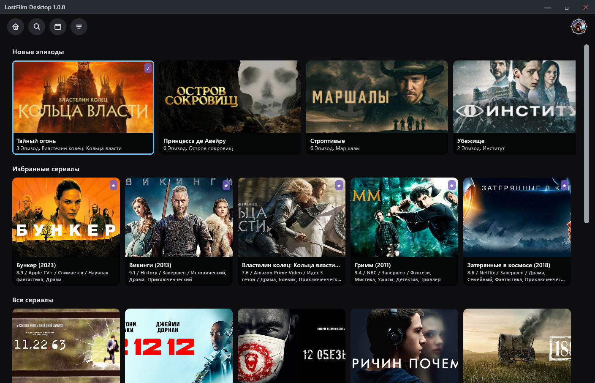

# LostFilm Desktop



Неофициальный десктопный клиент LostFilm.TV для Windows на Kotlin + Compose Desktop.
План и архитектура — в [PLAN.md](PLAN.md).

## Что работает

- вход по e-mail и паролю (других способов входа нет);
- главная: новые эпизоды, избранное, все сериалы, новые сериалы, фильмы;
- поиск, фильтры, календарь, карточки сериала и эпизода;
- воспроизведение через внешний плеер (VLC) и TorrServer;
- переключение зеркал, настройки, история и отметки просмотра, кэш картинок.

## Ограничения и известные проблемы

- вход только по почте и паролю; регистрация и восстановление пароля — на сайте;
- встроенного плеера нет: воспроизведение открывается во внешнем плеере (VLC можно
  скачать прямо из настроек приложения);
- не реализованы: скачивание серий на диск, уведомления о новых эпизодах,
  синхронизация истории с сайтом, автообновление приложения, сборки под Linux/macOS;
- сессия может слетать при смене зеркала — приложение предложит войти заново;
- первый полный каталог грузится не мгновенно: кэша каталога на диске пока нет
  (карточки первых страниц появляются сразу, остальное догружается в фоне);
- воспроизведение зависит от TorrServer и наличия пиров: если пиров нет, плеер
  ждёт данных, а не запускается мгновенно.

## Скачать

Готовый установщик — в разделе [Releases](../../releases/latest).
Устанавливается в профиль пользователя (`%LOCALAPPDATA%\Programs\LostFilmDesktop`)
без прав администратора.

## Требования для сборки

- Windows x64
- JDK 21 (`JAVA_HOME`)
- Gradle не нужен: используется wrapper

## Сборка

```powershell
.\gradlew.bat build                 # компиляция и тесты
.\gradlew.bat createDistributable   # портативный app-image
.\gradlew.bat portable              # копия в build\portable
.\gradlew.bat portableZip           # ZIP в build\dist
```

## Установщик

После `.\gradlew.bat portable` соберите кастомный установщик (C# 5, WinForms/GDI+,
без Inno Setup и NSIS):

```powershell
cd installer\src
powershell -ExecutionPolicy Bypass -File build.ps1
```

Готовый файл — `build\dist\LostFilmDesktop-Setup-1.0.0.exe`. По умолчанию
устанавливается в `%LOCALAPPDATA%\Programs\LostFilmDesktop` — в профиль текущего
пользователя, без прав администратора (запись в «Приложения» — в HKCU). Путь
корректно работает с любым именем пользователя: кириллица, пробелы, длинные имена.

Файлы берутся из `build\portable\LostFilmDesktop`, `Uninstall.exe` добавляется в
payload автоматически. Нужен .NET Framework 4.x (`csc.exe` из `v4.0.30319`).
Вариант с установкой в `Program Files` для всех пользователей: `build.ps1 -Admin`.

## Портативный запуск

```
build\portable\LostFilmDesktop\LostFilmDesktop.exe
```

Папка самодостаточна: внутри `app\`, `runtime\` и exe. Java на целевой машине не
нужна. Можно скопировать папку на флешку или другой компьютер с Windows x64.

ZIP для переноса:

```
build\dist\LostFilmDesktop-portable-1.0.0.zip
```

## Режим данных

- Портативный: `data\` рядом с exe (маркер `portable.marker`).
- Обычный: `%APPDATA%\LostFilmDesktop`.
- Настройки — `settings.properties`, cookies — `cookies.tsv`.

## Структура проекта

```
src\main\kotlin\app\lostfilm\desktop   исходники приложения и UI
src\test\kotlin                        тесты
installer\src                          кастомный установщик (C# 5, GDI+)
tools\torrserver                       TorrServer для портативной сборки
```

## Разработка

```powershell
.\gradlew.bat run
```

## Дисклеймер

Проект неофициальный и не связан с LostFilm.TV. Права на контент принадлежат
правообладателям. Используйте приложение только со своим аккаунтом и соблюдайте
законы своей страны.
